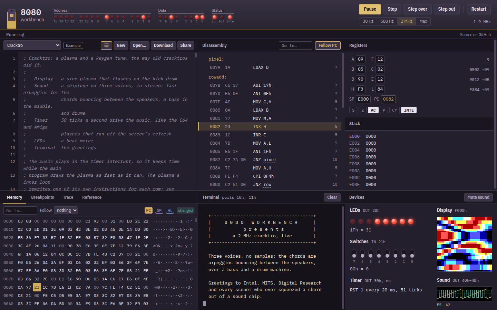

# 8080 Workbench

[](https://github.com/tedre191/8080-workbench/actions/workflows/ci.yml)

An Intel 8080 emulator that runs in your browser. You write assembly, and it
runs as you type on a small machine with a terminal, LEDs, switches, a timer, a
32×32 colour display and a three-voice sound chip.

**[tedre191.github.io/8080-workbench](https://tedre191.github.io/8080-workbench/)**



There are examples to start from, including Snake, Simon, and a cracktro with a
plasma and a chiptune. The classic CPU test programs are in the menu too, and
the CPU passes all of them.

Your programs are saved in the browser, and **Share** copies a link with the
program in it.

## Running it locally

You need Node 26 and pnpm. Node no longer comes with corepack, so install
pnpm with npm:

```sh
npm install -g pnpm
pnpm install
pnpm dev
```

## Keys

| Key             | Does                      |
| --------------- | ------------------------- |
| F1              | Open the reference        |
| F5              | Run / pause               |
| F11             | Step one instruction      |
| F10             | Step over CALL/RST        |
| Shift+F11       | Step out of a subroutine  |
| Esc             | Stop a step over or out   |
| Ctrl+Space      | Show suggestions          |
| Tab / Shift+Tab | Indent / outdent          |
| Alt+Z           | Turn line wrapping on/off |

Click a line number to set a breakpoint, and click any register, flag or memory
byte to change it. While a program runs, whatever you type outside the editor
goes to its terminal. On a touch screen, tap the terminal to bring up the
keyboard.

## The machine

| Device   | Where          | Notes                                                      |
| -------- | -------------- | ---------------------------------------------------------- |
| Terminal | ports 10h, 11h | Status and data; OUT 10h, 80h interrupts (RST 7) on keys   |
| LEDs     | OUT 20h        | One LED per bit                                            |
| Switches | IN 21h         | One switch per bit                                         |
| Timer    | OUT 30h, n     | RST 1 every n ms (0 stops)                                 |
| Display  | F000h–F3FFh    | 32×32 pixels, one byte each, 16 colours                    |
| Sound    | OUT 40h–4Bh    | 3 voices, 4 ports each: note, waveform, volume, stereo pan |
| CP/M     | ports FEh, FFh | Console support for `.COM` programs                        |

The Reference tab (F1) has the details, plus every instruction and some
snippets. It's also in [docs/REFERENCE.md](docs/REFERENCE.md). The timer and sound keep real time at every speed, so programs that
use the timer want 2 MHz or Max.

## The library

The emulator itself is in [`packages/core`](packages/core): the CPU, assembler,
disassembler and devices, with no dependencies. Its
[README](packages/core/README.md) covers the API and how to write your own
devices. The web app is in [`apps/web`](apps/web).

## Development

```sh
pnpm fetch-roms      # download the CPU exercisers, once
pnpm test
pnpm test:exm        # the full 8080EXM exerciser, about a minute
pnpm typecheck
pnpm lint
pnpm format
pnpm build
```

Run `pnpm test:exm` after changing `cpu.ts`. `docs/REFERENCE.md` is generated
from the Reference tab; a test fails when it's out of date, and
`pnpm --filter @i8080/web test -u` rewrites it. The library stays free of
dependencies and UI code: new hardware goes in `packages/core/src/devices/`
with a test, then gets a view in the workbench. Issues and pull requests are
welcome.

## License

[MIT](LICENSE). The CPU test programs aren't in this repository; they're
downloaded from [superzazu/8080](https://github.com/superzazu/8080) and keep
their own licenses.
